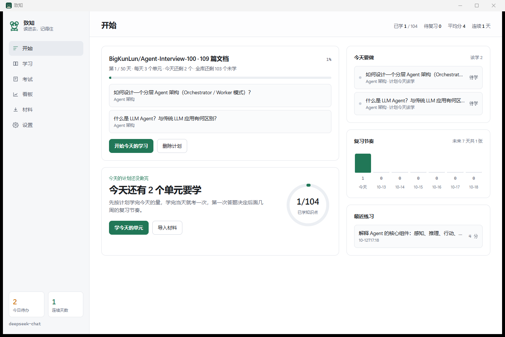
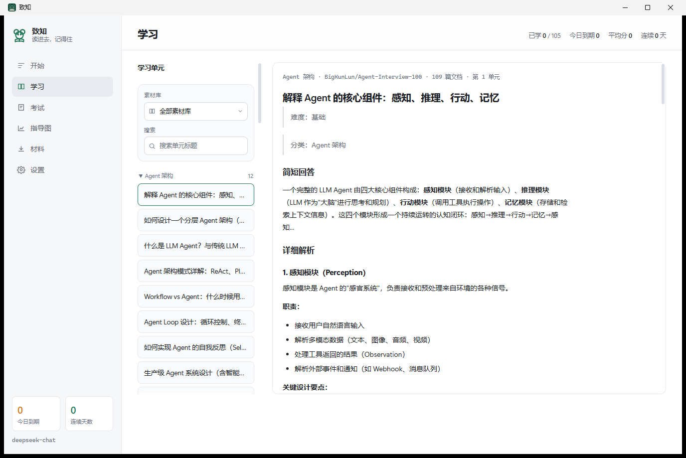
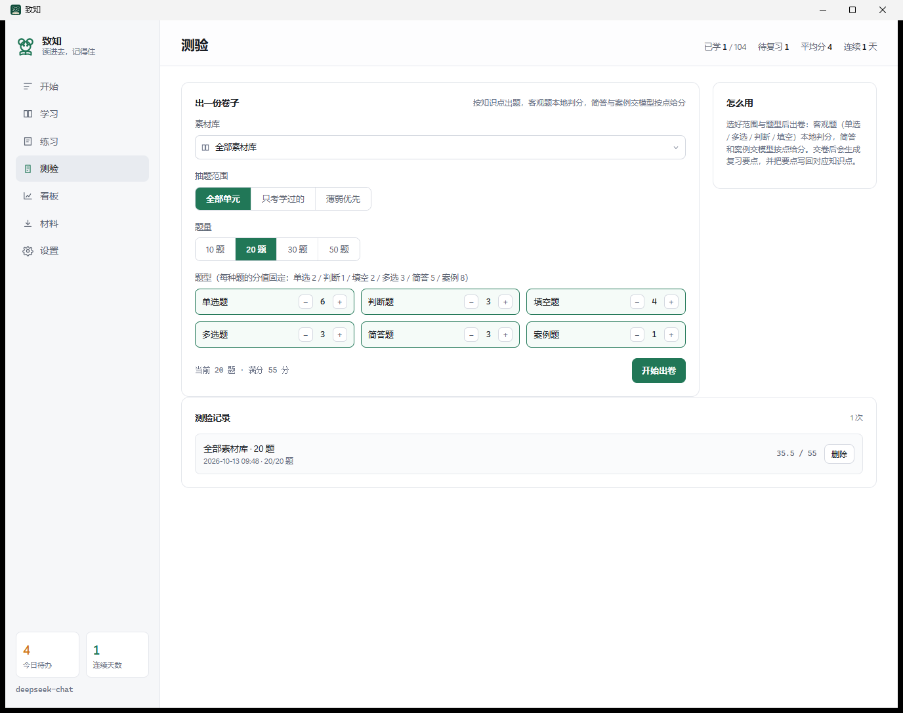
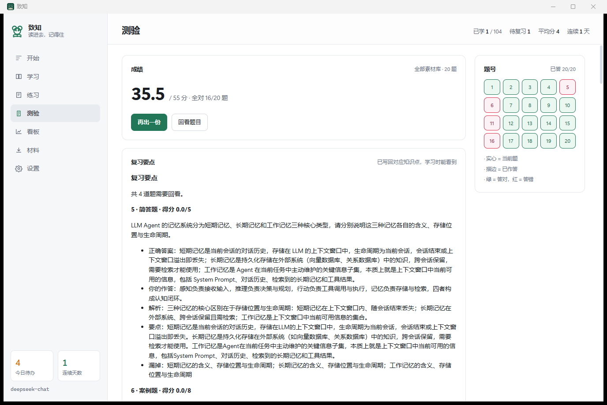
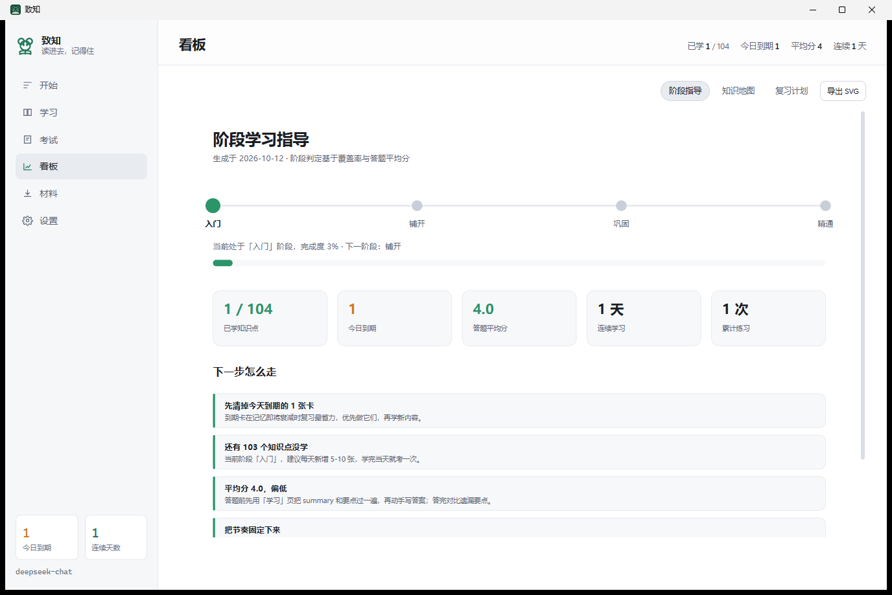
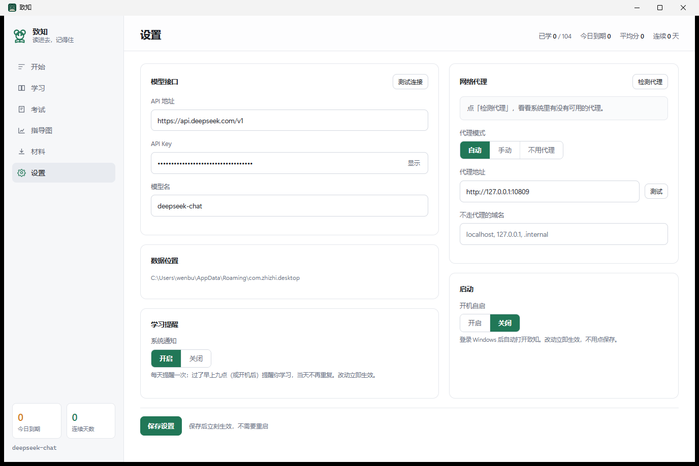

# 致知 · zhizhiStudy

> 把一份资料变成一套清晰的学习计划：知识点、自测题、复习安排，都在一个窗口里完成。

## 简介

学一门新东西，难的往往不是找资料，而是资料到手之后怎么办：读完了记不住，记住了又不知道什么时候该再看一遍。

致知把这件事做简单了。给它一个网页链接、一份 PDF 或 Word，或者直接粘贴一段文字，它会自动整理成一条条清晰的知识点，每条都配好讲解、要点和自测题。学完随手考一次，好在哪里、漏了什么，当场就知道，下一次该复习哪些内容也自动排好。今天要做什么、还剩多少、哪块最薄弱，打开首页一眼看清。

下载即可使用，界面只有七个页面，第一次打开也能直接上手。

## 界面

> 开始页：今天要做的都在这里，学完自动划掉。

> 学习页：左侧是按章节分好的目录，右侧是完整讲解，读完有要点和自测题。

> 测验：选好范围与题型，一份卷子自动出好。

> 交卷即出分，逐题回顾并生成复习要点，写到对应知识点上。

> 看板：知识地图、复习计划、阶段指导三张图，一眼看清进度。

> 设置：模型接口、网络代理、每日提醒、开机自启，改完立即生效。

## 功能

- 四种导入：网页链接、一个主题、本地文件（PDF / Word / Markdown）、直接粘贴
- 自动拆解：整理成一条条知识点，每条都有讲解、要点与自测题
- 练习与评分：作答后自动评分，给出评语、遗漏点与参考答案
- 测验出卷：六种题型自动组卷，软件内答题，交卷即出分与复习要点
- 定时复习：按记忆曲线安排每天该复习的内容，到点提醒
- 学习看板：知识地图、复习计划、阶段指导，可导出图片

## 快速开始

到 [Releases](https://github.com/wenbuer/zhizhiStudy/releases) 下载 `Zhizhi.exe`，双击运行即可，无需安装。

首次使用在「设置」页填写三项，保存后立刻可用：

| 字段 | 示例 |
|---|---|
| API 地址 | `https://api.deepseek.com/v1` |
| API Key | 你自己的 Key |
| 模型名 | `deepseek-chat` |

没有填写也能打开软件：材料可以正常导入整理，学习和看板都能用，只是自动出题与评分不可用，界面会说明原因。

## 复习怎么排

每次作答后，软件会按记忆曲线算出这张卡下次该复习的日期：答得越好，间隔拉得越久；答错或没把握，很快就再见到它。每天只需要清掉当天该做的部分，不必自己规划。

## 数据

所有内容都保存在本机，卸载或删除软件不影响已学记录。数据目录为 `%APPDATA%\com.zhizhi.desktop\`，删除其中的 `zhizhi.db` 即可从零开始。

## 从源码构建

需要 Rust 工具链（MSVC 目标）。

    cargo run --manifest-path src-tauri/Cargo.toml          # 开发运行
    cargo build --release --manifest-path src-tauri/Cargo.toml   # 生成可执行文件
    cargo test --manifest-path src-tauri/Cargo.toml          # 单元测试

## 许可

MIT，见 [LICENSE](LICENSE)。
