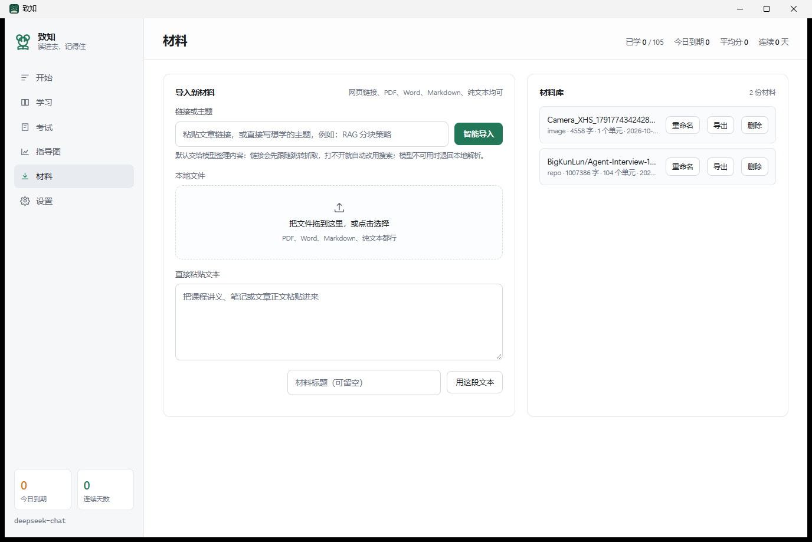
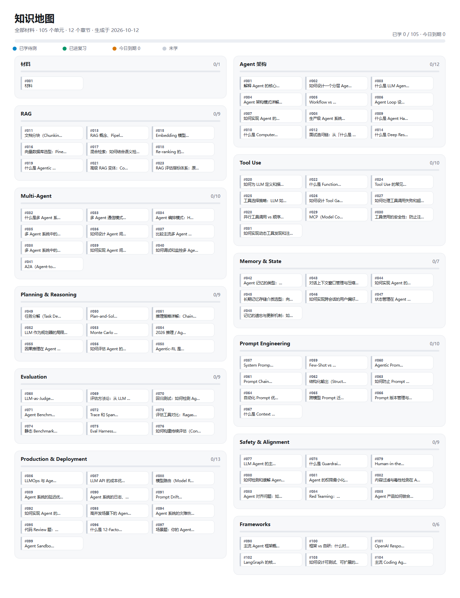
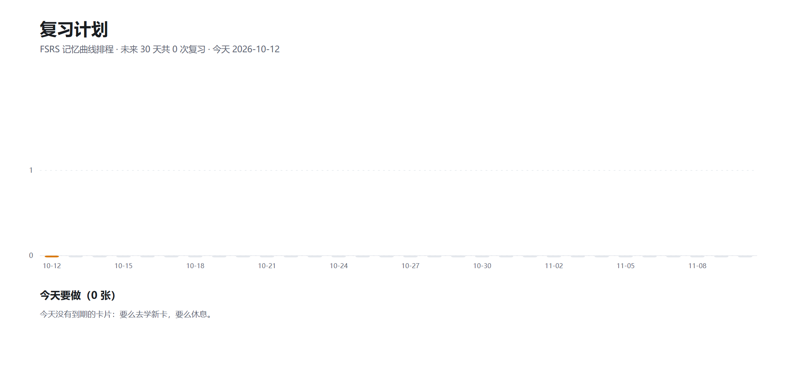
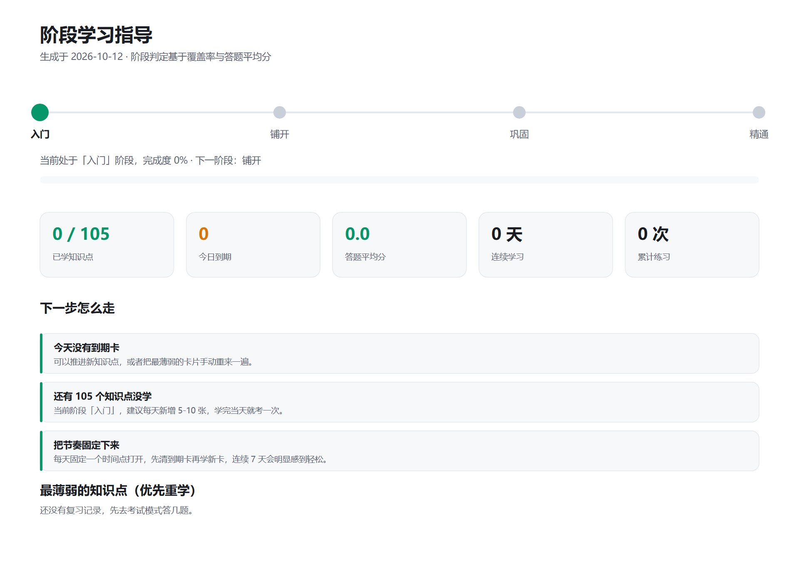

# 致知 · Study4Me

> 把一份材料变成一套学习与考试系统：拆出知识点、出题判分、按记忆曲线排复习，并把学习状态画成能直接看的指导图。Windows 桌面应用。

## 简介

学一门新东西最难的不是找资料，而是**把资料变成能复习的东西**：读完了记不住，记住了又不知道哪天该再看一遍。

致知把这套流程做进一个本地应用：给它一个网页链接、一份 PDF / Word / Markdown，或一段直接粘贴的文本，
它拆出可独立复习的知识点，每个都带完整讲解、要点、考题与参考答案；学完就去考，模型对照参考答案打分，
分数换算成 FSRS 评分排下次复习时间；最后把你现在的知识结构和未来一个月的复习节奏画成图。

技术上是一个 Tauri 2 应用：Rust 负责抓取、解析、排程与数据库，前端是零构建的原生 HTML/CSS/JS。
所有数据都在本机 SQLite 里，除了调用你配置的模型接口，不上传任何内容。

## 界面

> 开始页：学习计划进度、今天要学的单元、到期卡与学习阶段统计。

> 材料页：链接 / 主题 / 本地文件 / 粘贴文本四条导入路径，右侧是材料库，可重命名、导出 Markdown、删除。

> 学习页：左侧按章节折叠的单元目录，带素材库切换与标题搜索；右侧是完整讲解，读完有要点清单和自测题。

### 指导图

三张图都由程序直接生成 SVG，可缩放、可导出。

> 知识地图：按章节聚类展示全部知识点，颜色表示未学 / 到期 / 已掌握。

> 复习计划：未来 30 天每天到期的卡片数量与当日压力。

> 阶段指导：根据当前进度给出的下一步动作建议。

> 设置页：模型接口、网络代理、开机自启，改完立即生效，不用重启。

## 功能

- **四种导入方式**：网页链接、只写一个主题（自动搜索同主题资料）、本地文件（PDF / Word / Markdown / 纯文本）、直接粘贴文本
- **整仓导入**：给一个 GitHub 仓库地址，会把仓库里的全部 Markdown 文档抓下来合成一份材料
- **模型整理 + 本地兜底**：抓回来的原始文本默认交给模型整理成干净材料（去导航广告、合并多来源、保留结构）；模型不可用时自动退回本地解析，导入不中断
- **学完再考**：材料按标题切成学习单元，原文完整入库，不用等模型就能开始读；考点（摘要 / 要点 / 考题 / 答案）分步生成，进度可见
- **AI 评判**：作答后对照参考答案打分，给出评语、遗漏点与理想回答，分数自动映射成 FSRS 四档评分
- **FSRS 排程**：Anki 默认的记忆曲线算法，目标保持率 0.9，每天只需清掉当天到期的卡
- **学习计划**：给某份材料设定天数与每天单元数，自动生成逐日计划，首页直接开始今天的学习
- **三张指导图**：知识地图、复习计划、阶段指导，一键导出 SVG
- **网络代理自动检测**：环境变量 → Windows 系统代理 → 常见本地端口逐级探测，也可以在设置页手动指定
- **开机自启**：设置页一个开关，写当前用户的启动项，不需要管理员权限

## 快速开始

到 [Releases](https://github.com/wenbuer/Study4Me/releases) 下载 `Zhizhi.exe` 直接运行，Windows 10/11 自带 WebView2，无需安装其他依赖。

首次启动后在**设置**页填模型接口（默认 DeepSeek 官方）：

| 字段 | 示例 |
|---|---|
| API 地址 | `https://api.deepseek.com/v1` |
| API Key | `sk-...` |
| 模型名 | `deepseek-chat` |

也可以把这些写在项目根目录的 `.env` 里作为首次启动的默认值（`.env` 已在 `.gitignore` 中，Key 不会被提交）：

    LLM_API_KEY=sk-...
    LLM_API_BASE=https://api.deepseek.com/v1
    LLM_MODEL=deepseek-chat

没有 Key、余额不足或接口报错时应用照常启动：导入退回本地解析，学习、复习与图表都能用，
只有拆考点与判分不可用，界面会直接告诉你失败原因（比如把模型填成了思考型模型，会提示换成 `deepseek-chat`）。

### 换一家模型服务

任何 OpenAI 兼容接口都能接，改设置页三行或 `.env` 三行即可。常见选择：DeepSeek 官方（默认）、
SiliconFlow、阿里百炼、智谱 GLM。

## 记忆曲线

排程用 FSRS（Free Spaced Repetition Scheduler），由 `fsrs` crate 提供实现，目标保持率 0.9：
只有模型判断你还有九成把握记得时，才会把这张卡推到更远的未来。

| 答对程度 | FSRS 评分 | 效果 |
|---|---|---|
| 0 到 4 分 | 忘记 | 当天或次日重来，计入遗忘次数 |
| 5 到 6 分 | 有点难 | 间隔小幅增加 |
| 7 到 8 分 | 记得 | 间隔正常增加 |
| 9 到 10 分 | 太简单 | 间隔大幅增加 |

也可以不用模型，直接在考试页右侧用四档自评。

## 网络代理

很多站点不挂代理打不开。代理模式默认「自动」，按下面的顺序找：

1. 环境变量 `HTTPS_PROXY` / `HTTP_PROXY` / `ALL_PROXY`
2. Windows 系统代理（设置 → 网络和 Internet → 代理）
3. 本地正在监听的常见代理端口（10809 / 7890 / 7897 / 10808 / 8889 / 1080 / 8080 / 8888）

都没有就直连。设置页可以手动指定地址、切换模式（自动 / 手动 / 不用代理）、填不走代理的域名，
点「测试」会立刻用当前设置抓一次 `https://www.google.com/`，能通说明代理真的生效。

> 为什么要自己探测：reqwest 只认环境变量，不读 Windows 系统代理。装了 v2rayN / Clash 但没设环境变量时，
> 程序会以为自己在直连，于是所有被墙的站点都抓不到。

## 数据

- 数据库：`%APPDATA%\com.zhizhi.desktop\zhizhi.db`（SQLite，单文件，可备份）
- 设置：同目录的 `config.json`；导出的 SVG 与 Markdown 在你选择的路径
- 想从零开始：关掉程序，删掉 `zhizhi.db` 即可
- 除调用你配置的模型接口外，不向任何服务器上传内容

## 从源码构建

需要 Rust 工具链（MSVC 目标）；Node 不是必需的。

    # 开发运行
    cargo run --manifest-path src-tauri/Cargo.toml

    # 发布版可执行文件（产物在 src-tauri/target/release/Zhizhi.exe）
    cargo build --release --manifest-path src-tauri/Cargo.toml

    # 单元测试
    cargo test --manifest-path src-tauri/Cargo.toml

    # 应用图标（改图标后要 cargo clean 才会重新嵌入）
    python scripts/make_icon.py --all

装好 Tauri CLI 后，还可以用 `tauri build` 生成 NSIS 安装包（配置见 `src-tauri/tauri.conf.json`）。

## 目录结构

    src-tauri/             Rust 内核
      src/autostart.rs     开机自启：读写当前用户的启动项
      src/ingest.rs        链接 / PDF / Word / Markdown / 纯文本 到文本与学习单元
      src/llm.rs           模型调用：整理材料、生成考点、评判作答
      src/store.rs         SQLite：材料、单元、复习记录、计划、统计
      src/srs.rs           FSRS 排程与评分映射
      src/graph.rs         三张指导图的 SVG 生成
      src/lib.rs           Tauri 命令与状态
    src/                  前端（零构建）
      index.html           六个视图的骨架
      styles.css           浅色单强调色设计系统
      app.js               视图逻辑与命令调用
    scripts/make_icon.py   参数化生成应用图标与品牌标记
    shots/                 README 配图

## 许可

MIT，见 [LICENSE](LICENSE)。
